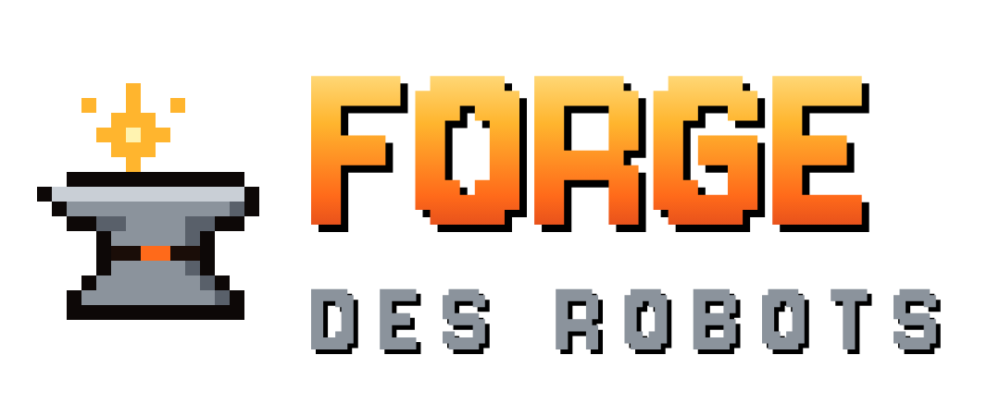

# Forge des Robots

*Forge ton robot. Fais trembler l'arène.*

Jeu de combat de robots en pixel art, pour Android. Crée ton robot (couleurs, casque, canon, stats) et affronte l'ordinateur ou jusqu'à 7 amis en Bluetooth.

## Contenu

- 6 arènes destructibles et 2 fois plus grandes, avec des étages de plateformes, des tours et des falaises (ville, forêt, montagne, volcan, mer, arctique) avec leurs effets : lave qui monte, marée, vent, glace. Le fond de l'arène est mortel.
- Règles : chacun pour soi, équipes rouge contre bleue, vagues de monstres en coop.
- Menu à 3 portes : Histoire, Arène, Forge.
- Mode histoire complet : 5 chapitres, 30 missions, en solo ou en coop Bluetooth. Chaque mission est un long niveau à défilement : on avance vers la droite, des zones de combat bloquent le passage jusqu'à ce que les ennemis tombent, et la sortie ou l'arène du boss attend au bout. 3 vies par robot. Chaque chapitre débloque un objet à la forge, et un secret se cache dans la première mission.
- Option « monstre joueur » : à 3 vrais joueurs ou plus, un joueur tiré au sort contrôle le monstre.
- Jetpack pour tous les robots (réservoir qui se recharge au sol), avec plusieurs modèles à choisir à la forge.
- Deux boutons de tir : TIR tire en continu et se dirige en glissant le pouce, CHARGE garde le tir chargé. À la souris : clic gauche et clic droit.
- Décors vivants : lampadaires, enseignes, fleurs, sapins, fumerolles, algues, cristaux, petites bêtes et ciel animé.
- 6 monstres géants (dont le Mimic, le Colosse de ferraille et la Soucoupe pilleuse), bonus et objets spéciaux (bouclier, turbo jet, mines, grappin).
- Robots ordinateur pour compléter une partie, tableau des scores, mode spectateur.
- Pièces gagnées selon ta place parmi les vrais joueurs (12/8/4/2 à 4 joueurs ou plus, 6/4/2 à 3, 2/1 à 2, 1 seul contre l'IA) pour débloquer casques, finitions et canons.
- Musique chiptune originale et vibrations.

## Installer l'app

1. Ouvre la page **Releases** du dépôt sur ton téléphone et télécharge `forge-des-robots.apk` (version « apk-latest »).
2. Ouvre le fichier. Android demande d'autoriser l'installation depuis le navigateur : accepte.
3. Lance **Forge des Robots**.

Chaque push sur `main` refabrique l'APK automatiquement (onglet Actions).

## Jouer en Bluetooth (2 à 8 joueurs)

1. Tout le monde choisit son robot dans « Joueur 1 », puis le mode **Bluetooth**.
2. Un joueur touche **Héberger** et accepte que son téléphone soit visible.
3. Les autres touchent **Chercher une partie**, puis le nom du téléphone de l'hôte.
4. L'hôte choisit la règle et le décor, ajoute s'il veut des robots ordinateur avec **+**, puis touche **Lancer la partie**.

Au-delà de 4 joueurs, le Bluetooth peut ralentir un peu la synchronisation.

## Structure

- `app/src/main/assets/index.html` : le jeu (HTML/JS, un seul fichier).
- `app/src/main/java/fr/forgedesrobots/BtBridge.java` : serveur et client Bluetooth (RFCOMM), exposé au jeu sous `window.AndroidBT`.
- `MainActivity.java` : affiche le jeu dans une WebView plein écran.
